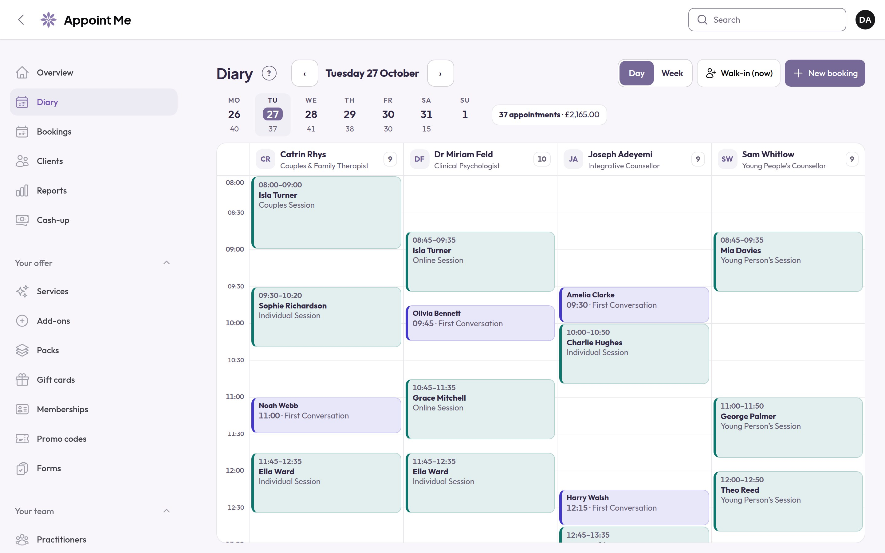
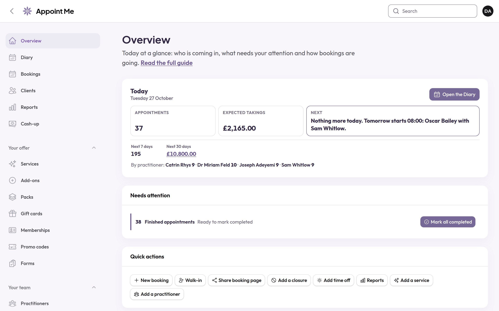
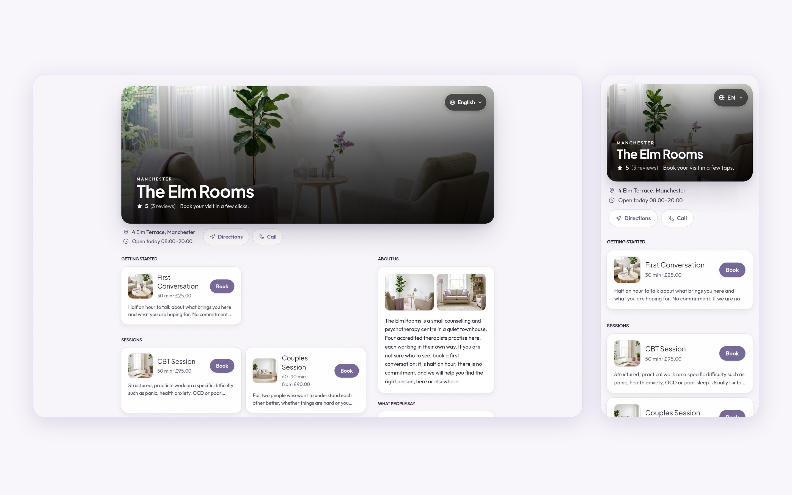
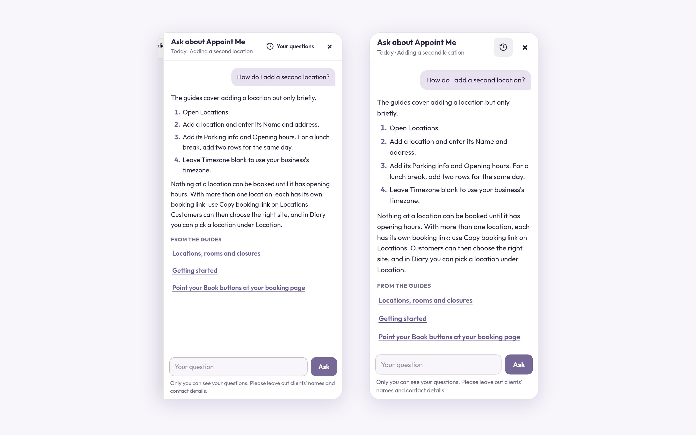
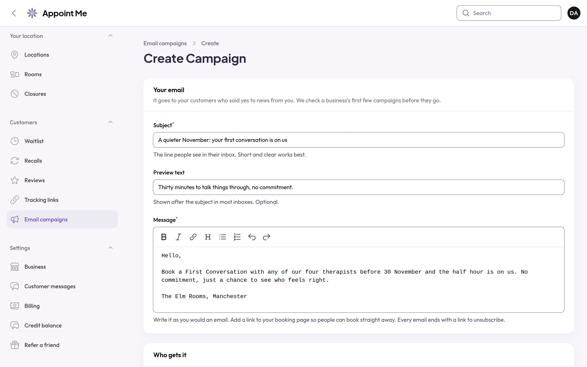
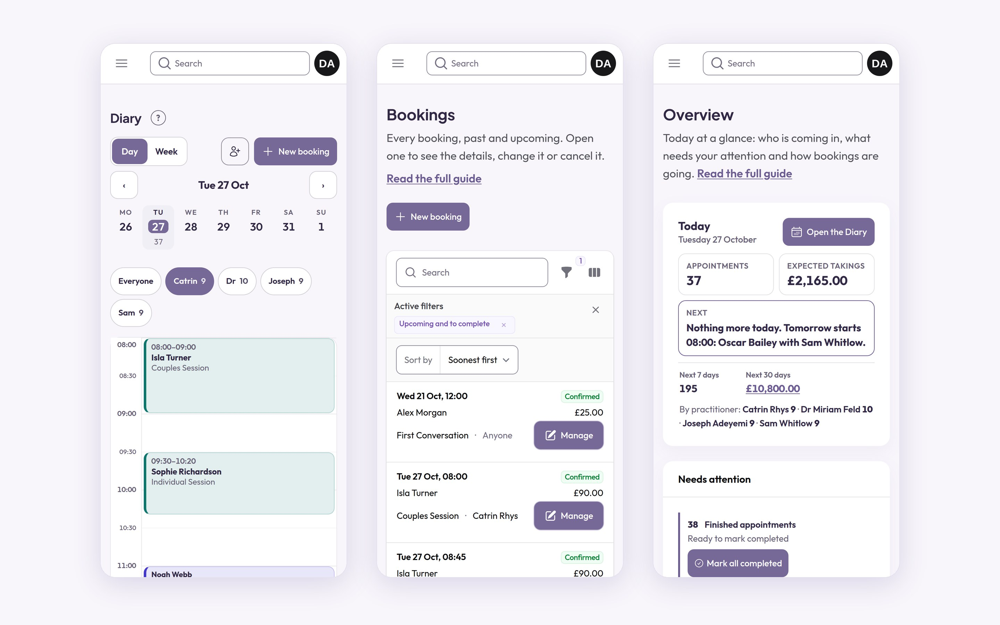

# Appoint Me Booking System: press kit

**Appoint Me** is the online booking system for businesses that take appointments, from one site to twenty: clinics, physios, spas, salons, trades, barbers and more. One flat price per location, unlimited staff, 0% commission on every booking, and every feature included.

Website: [appointme.com](https://appointme.com) · Press page: [appointme.com/press](https://appointme.com/press) · Contact: support@appointme.com

Everything in this repository is free to use when writing about Appoint Me. It is the same kit as the [download on our press page](https://appointme.com/press-kit/appointme-press-kit.zip).

## Fact sheet

| | |
|---|---|
| What it is | An online booking system for businesses that take appointments |
| Price | £50 a month for the first location, £40 a month for each extra location |
| Getting started | The first month is £5; while the founding places last, the first 6 months are £5 in total |
| Staff and bookings | Unlimited, every feature included |
| Commission | 0% on every booking |
| Payments | Deposits, no-show fees, saved cards, tips and prepaid sessions, paid into the business's own Stripe account |
| Switching | Free switching service: send the old booking system's exports and we rebuild clients, diary and history |
| Languages and currencies | 19 languages, 17 currencies |
| Runs on | Any web browser, on any device |
| Made by | GK Tools Ltd, London (company 16434833) |

The plain-text version is [appointme-fact-sheet.txt](appointme-fact-sheet.txt).

### Short description (for listings)

> Appoint Me is the online booking system for businesses that take appointments, from one site to twenty. A flat price per location with unlimited staff and 0% commission, deposits paid into your own Stripe account, and every feature included.

## Logos

| File | Use it on |
|---|---|
| [appointme-logo.svg](logo/appointme-logo.svg) · [PNG 1200](logo/appointme-logo-1200.png) | Light backgrounds |
| [appointme-logo-on-dark.svg](logo/appointme-logo-on-dark.svg) · [PNG 1200](logo/appointme-logo-on-dark-1200.png) | Dark backgrounds |
| [appointme-logo-white.svg](logo/appointme-logo-white.svg) · [PNG 1200](logo/appointme-logo-white-1200.png) | Photos and strong colours |
| [appointme-mark.svg](logo/appointme-mark.svg) · [PNG 512](logo/appointme-mark-512.png) · [PNG 1024](logo/appointme-mark-1024.png) | App icons, avatars, small spaces |
| [appointme-mark-on-dark.svg](logo/appointme-mark-on-dark.svg) · [PNG 512](logo/appointme-mark-on-dark-512.png) | The mark on dark backgrounds |

Please keep the logo as it is: no recolouring, stretching, outlines or shadows, and leave a little space around it. The name is written **Appoint Me**: two words, capital A and M.

## Screenshots

| | |
|---|---|
|  | **The Diary.** One day, a column for each person. |
|  | **The Overview.** Today's appointments, expected takings and what needs attention. |
|  | **The booking page** customers book on, on a computer and a phone. |
|  | **Ask Appoint Me.** Answers from the guides, on a computer and a phone. |
|  | **Email campaigns** to customers who said yes to news. |
|  | **On a phone.** The Diary, Bookings and Overview, wherever you are. |

Tall images for stories and short videos are in [video/](video/).

## About GK Tools

Appoint Me is made by [GK Tools](https://gk.tools), a software company in London. We also make [Invoicer](https://invoicer.gk.tools), simple invoicing for tradespeople, and [Gravity Host](https://gravityhost.co.uk), UK web hosting.

Follow us: [X](https://x.com/GK_Tools) · [Instagram](https://www.instagram.com/gk_tools_ltd/) · [Facebook](https://www.facebook.com/GKToolsLtd) · [YouTube](https://www.youtube.com/@GKToolsLtd) · [TikTok](https://www.tiktok.com/@gk_tools)

## Licence

You may use these logos, screenshots and images to write about, review, list or link to Appoint Me. They are not for other products or for anything suggesting we endorse something we have not. Appoint Me and its logo are trademarks of GK Tools Ltd. Questions: support@appointme.com.
